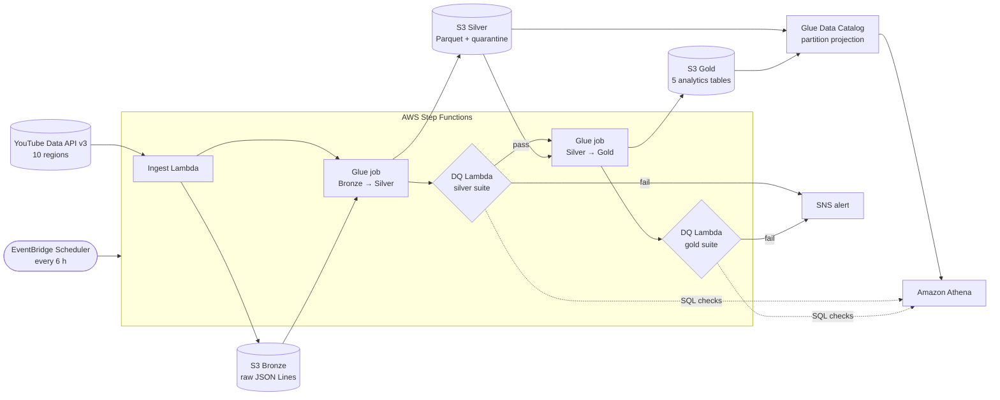

# YouTube Trending Data Pipeline


-yellow)


A cloud-native ETL pipeline that ingests YouTube's most-popular ("trending") videos for
**10 regions**, then cleans and aggregates them through a **Medallion architecture**
(Bronze → Silver → Gold). Automated **data quality gates** run between the layers, and the
analytics tables can be queried in **Amazon Athena**.

All the infrastructure is defined in one AWS SAM / CloudFormation template. The whole pipeline
also runs **offline on your laptop**, with no AWS account needed, using the same code.

## Architecture



| Service | Role |
|---|---|
| **AWS Lambda** | `ingest` pulls the `videos.list?chart=mostPopular` chart and the category lookups for each region. `data_quality` runs SQL rule suites through Athena. |
| **AWS Glue (PySpark 5.0)** | `bronze_to_silver` applies a schema, types and cleans the data, adds category names, removes duplicates and quarantines bad rows. `silver_to_gold` builds the daily aggregates. |
| **Amazon S3** | Data lake with `bronze/`, `silver/`, `gold/` and `dq/` zones. Encrypted, versioned, with lifecycle rules (Bronze moves to IA/Glacier-IR). |
| **AWS Step Functions** | Runs the steps in order, with retries, quality-gate branches, SNS alerts and a CloudWatch alarm. |
| **Amazon Athena** | Glue Catalog tables use **partition projection**, so no crawlers or `MSCK REPAIR` are needed. Six saved analytics queries come with the stack. |

## Medallion layers

| Layer | Location | Format | What happens |
|---|---|---|---|
| **Bronze** | `bronze/youtube/{trending_videos,video_categories}/region=/ingest_date=/ingest_hour=/<run>.jsonl` | JSON Lines | Raw API items stored **unchanged**, wrapped with ingestion metadata (run id, region, timestamp, trending rank). Can be replayed later. |
| **Silver** | `silver/trending_videos/trending_date=/ingest_hour=/region=` | Parquet | Explicit schema. String counters become `bigint`, ISO-8601 timestamps and `PT1H2M3S` durations are parsed. Category names are joined in per region. Derived features: engagement rate, hours-to-trend, tag count, title length. Duplicates on `(video_id, region)` per run are removed. |
| **Silver quarantine** | `silver/quarantine_trending_videos/` | Parquet | Rows that fail row-level rules (missing id, bad date, missing views, negative metrics, unknown region), stored with a `quarantine_reason` and the raw record. |
| **Gold** | `gold/<table>/trending_date=` | Parquet | Business aggregates, rebuilt per day (idempotent dynamic partition overwrite). |

### Gold tables

| Table | Grain | Highlights |
|---|---|---|
| `gold_daily_video_trending` | region × video × day | best/latest rank, intraday snapshots, **view gain**, first/last seen |
| `gold_region_daily_kpis` | region × day | unique videos, median views, avg engagement, avg hours-to-trend, HD & captions share |
| `gold_region_category_daily` | region × category × day | category mix (`share_of_videos`) and engagement |
| `gold_channel_daily_leaderboard` | region × channel × day | channels ranked by trending views |
| `gold_cross_region_daily` | video × day | videos trending in several regions at once (global virality) |

## Automated data quality

There are two levels of checks:

1. **Row-level rules** in the Silver Glue job. Records that break them are quarantined rather than dropped, so nothing is lost silently.
2. **Dataset-level rule suites** run by the DQ Lambda through Athena after each Glue job. The rules are declarative SQL (`src/lambdas/data_quality/rules.py`), and every result is written to the `dq_results` table.

| Suite | Check | Severity |
|---|---|---|
| silver | row count > 0 · ≥ 8 of 10 regions present · no null keys · `(video_id, region)` unique · no negative metrics · rank in 1–200 | **critical** |
| silver | all 10 regions present · likes ≤ views · ≤ 5 % missing categories · ≤ 10 % quarantine rate | warning |
| gold | Gold ↔ Silver reconciliation · one KPI row per region · category shares sum to 1 · unique leaderboard ranks · `regions_count` bounds | **critical** |
| gold | non-negative intraday view gain | warning |

A **critical** failure sends the run down `NotifyQualityFailure`, which publishes an SNS alert, and then to the `Fail` state. **Warnings** are recorded and alerted, but the run still finishes.

## Quick start: run it locally (no AWS needed)

The local runner runs the real Lambda and Glue code in pipeline order. It uses a local folder
instead of S3, local Spark instead of Glue, and Spark SQL instead of Athena. The data comes from a
**synthetic YouTube API fake** that includes deliberately broken records, so the quality rules
have something to catch.

```bash
git clone https://github.com/divyanjali123-tyagi/youtube-trending-data-pipeline.git
cd youtube-trending-data-pipeline
pip install -r requirements-dev.txt     # needs Java 17+ for PySpark
python scripts/run_local.py             # writes ./local_lake/{bronze,silver,gold}
```

Example output (full version in [`docs/sample_local_run.txt`](docs/sample_local_run.txt)):

```text
[local-20261025T09] ingest: 510 videos from 10 regions
  bronze -> silver: {'silver_rows': 480, 'quarantined_rows': 20}
  DQ silver -> PASSED (10 checks)
  silver -> gold:   {'daily_video_trending': 480, 'region_daily_kpis': 10, ...}
  DQ gold   -> PASSED (6 checks)
```

To use real YouTube data locally, set `YOUTUBE_API_KEY` and run `python scripts/run_local.py --live`.

**On Windows**, PySpark needs extra Hadoop setup, so the easiest option is Docker:

```bash
docker build -t yt-pipeline .
docker run --rm yt-pipeline                 # offline run
docker run --rm yt-pipeline pytest          # test suite
```

## Deploy to AWS

**Prerequisites:**
- an AWS account with the [AWS CLI](https://aws.amazon.com/cli/) configured (`aws configure`)
- the [AWS SAM CLI](https://docs.aws.amazon.com/serverless-application-model/latest/developerguide/install-sam-cli.html)
- Python 3.10+ with `boto3`
- a YouTube Data API key. To get one: open the [Google Cloud Console](https://console.cloud.google.com/) → create a project → **APIs & Services → Library** → enable **YouTube Data API v3** → **Credentials → Create credentials → API key**.

```bash
# 1. Deploy everything. This stores the key in SSM Parameter Store (SecureString), creates the
#    stack and uploads the Glue scripts.
python scripts/pipeline_ctl.py deploy --api-key YOUR_YOUTUBE_API_KEY --alert-email you@example.com

# 2. Run the pipeline now instead of waiting for the 6-hour schedule
python scripts/pipeline_ctl.py run

# 3. See recent executions
python scripts/pipeline_ctl.py status
```

Then open **Athena** → workgroup `youtube-trending-pipeline-analytics` → database
`youtube_trending`. The ready-made queries are under **Saved queries**. The same SQL is in
[`sql/`](sql/):

| Query | Question it answers |
|---|---|
| `top-videos-by-region` | What's trending right now in each country? |
| `category-mix-by-region` | Which categories dominate each region? |
| `global-viral-videos` | Which videos trend in 3+ countries at once? |
| `channel-leaderboard` | Which channels own the trending charts? |
| `region-kpi-trends` | How fast do videos trend, and how engaged are viewers, by region? |
| `data-quality-history` | Which quality checks failed recently? |

**Configuration:** you can override any template parameter. The defaults are:
- regions `US,GB,IN,CA,AU,DE,FR,JP,KR,BR`
- up to 200 videos per region
- schedule `rate(6 hours)`
- at least 8 regions per run (critical quality threshold)

To deploy without a schedule, use `--schedule DISABLED`.

**Cost:** Lambda, Step Functions, S3, Athena and SNS cost cents per month at this volume.
The main cost is Glue. Two G.1X jobs with 2 workers each, running for a few minutes four
times a day, come to **roughly $5 a month** at standard Glue prices. Disable the schedule
when you're not demoing it.

**YouTube quota:** each run uses about 50 of the free 10,000 daily API units. That's 4 pages
plus 1 category lookup for each of 10 regions.

**Tear down:**

```bash
python scripts/pipeline_ctl.py destroy      # deletes the stack and empties/deletes the data lake bucket
```

## Project structure

```text
├── infrastructure/
│   ├── template.yaml               # AWS SAM: S3, Lambda, Glue jobs + catalog, Step Functions, Athena, SNS
│   └── statemachine/pipeline.asl.json
├── src/
│   ├── lambdas/ingest/ingest_handler.py      # YouTube API -> Bronze (pagination, retries, quota handling)
│   ├── lambdas/data_quality/dq_handler.py    # Athena rule runner + quality gate
│   ├── lambdas/data_quality/rules.py         # declarative Silver/Gold DQ rules (portable SQL)
│   ├── glue/bronze_to_silver.py              # PySpark: Bronze -> Silver (+ quarantine)
│   └── glue/silver_to_gold.py                # PySpark: Silver -> Gold
├── sql/                            # Athena analytics queries (deployed as saved queries)
├── scripts/
│   ├── pipeline_ctl.py             # deploy / run / status / destroy (cross-platform)
│   ├── run_local.py                # offline end-to-end run
│   └── fake_youtube_api.py         # synthetic YouTube API for offline runs and tests
├── tests/                          # 43 tests: ingest, transforms, DQ, infrastructure consistency
├── docs/architecture.md            # design decisions
└── .github/workflows/ci.yml        # lint, template validation, tests
```

## Testing

```bash
pytest                                   # 43 tests, all offline (moto for S3/SSM, local Spark for Glue)
ruff check .
cfn-lint infrastructure/template.yaml
```

Besides unit tests, `tests/test_infrastructure.py` keeps the code and the infrastructure in sync. It checks that:
- every Glue Catalog table's columns and types match what the Spark jobs actually write
- every Step Functions state is reachable and has error handling
- every argument a Glue job needs is supplied
- the saved Athena queries match the files in `sql/`

## Notes

- Since **July 21, 2025**, YouTube's `mostPopular` chart has been built from the **Trending Music, Movies and Gaming** charts, because the Trending page was retired. The API call and data shape are the same.
- Insights come from public metadata and statistics only, not video content.
- More detail on the design decisions is in [`docs/architecture.md`](docs/architecture.md).

## License

MIT, see [LICENSE](LICENSE).
